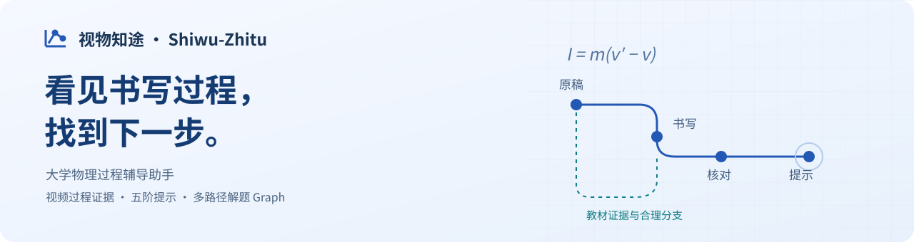
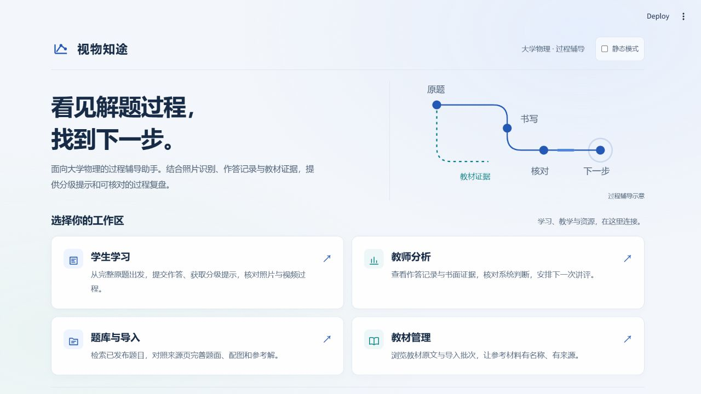
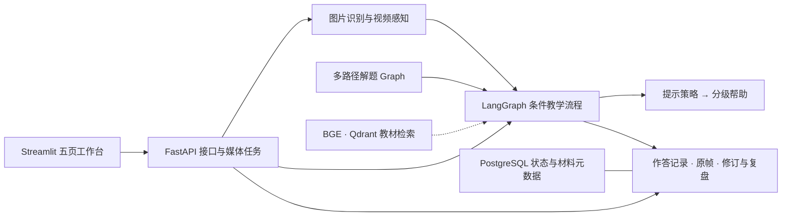

<div align="center">



<br />

[](https://github.com/suh52262-rgb/shiwu-zhitu/actions/workflows/tests.yml)
[](https://www.python.org/downloads/)
[](LICENSE)

**照片即时辅导 · 视频过程复盘 · 教师证据核对 · 题目与教材管理**

[功能亮点](#功能亮点) · [五阶提示](#五阶提示) · [快速开始](#快速开始) · [技术方案](#技术方案) · [文档与验证](#文档与验证)

</div>

视物知途是一款面向大学物理学习的**过程辅导助手**。从学生已经写出的内容出发，结合照片、作答视频与教材证据，定位当前步骤，提供由浅入深的帮助，并让分析结论可以回到原文、原帧和修订记录中核对。

## 工作台一览



一个导览连接四个工作区，保持学习、教学与资源管理的使用上下文。上图为项目静态导览截图，素材来源见[记录](docs/assets/readme/provenance.json)。

## 为什么保留作答视频

最终图片呈现的是留下来的内容。过程视频还能保留采样范围内**公式何时新增、哪里发生修改、方向说明何时补写**等线索，为下一步提示和课后复盘提供更多依据。

- **正在求助时**：用照片或文字核对当前一步，先获得提示，继续作答。
- **需要回看时**：上传过程视频，按时间查看原画面、识别原文与分析记录。
- **发现误读时**：更正识别，让当前分析跟随修订版本，保留已有历史。

书写出现的先后可以观察；学生脑中的推导顺序、理解程度与动机仍需谨慎判断。项目将**原始材料、系统分析和核对时重建**分开呈现。

## 功能亮点

| 功能 | 可以做什么 |
| :--- | :--- |
| **照片与文字辅导** | 核对识别原文、获得当前步提示，更正后继续同一次作答。照片主路径与完整复盘分开。 |
| **视频过程复盘** | 后台处理视频、查看任务进度、按编号找回任务，核对时间点、原帧及修订后的报告。 |
| **五阶提示** | 按当前状态决定帮助级别，从方向引导逐步展开到当前步骤讲解。 |
| **多路径解题 Graph** | 以步骤、关键推理与合理分支组织参考解，辅助匹配不同书写和等价路线。 |
| **教材 RAG** | 本地向量检索结合按需重排，为提示补充实际发送的教材片段及来源页。 |
| **AI + OCR 题目导入** | PDF / 图片形成可核对草稿，检查题干、配图和参考解；发布题目后独立生成、审核候选 Graph。 |
| **教师证据核对** | 查看作答记录与系统判断，对照书面依据进行复核，区分历史记录与当前有效问题。 |
| **教材资源管理** | 展示教材清单、原文和导入批次；实际教材解析与索引沿用现有工具。 |

## 五阶提示

系统先决定本轮提示级别，再由模型生成对应内容。**主动求助并不直接等于提供整题答案。**

以下以自编小车题为例说明提示强度，属于设计示例，不是五次模型实测：

| 等级 | 帮助方式 | 示例 |
| :---: | :--- | :--- |
| **L1** | 方向提示 | 先检查一下：合成这些作用时，方向是否需要区分？ |
| **L2** | 概念提示 | 牵引力与阻力方向相反，求合力时需要考虑方向。 |
| **L3** | 方法提示 | 先选正方向，求各力的代数和，再使用牛顿第二定律。 |
| **L4** | 关键步骤 | 若取向右为正，先列 `F合 = F牵 − f`，再列 `a = F合 / m`。 |
| **L5** | 当前步讲解 | 当前先核对合力：`10 − 2 = 8 N`，方向向右；后续小问继续由学生完成。 |

无需干预时可以保持 **L0**。L5 只展开当前步骤；是否升级由状态与策略决定，不承诺每次点击都机械升一级。

## 快速开始

推荐环境：**Windows x64 · Python 3.11**。仅查看导览需要 Python 依赖；完整教学另外需要 PostgreSQL、Qdrant、本地 BGE 与模型账户配置。

### 先打开导览

```powershell
git clone https://github.com/suh52262-rgb/shiwu-zhitu.git
cd shiwu-zhitu

py -3.11 -m venv .venv
.\.venv\Scripts\python.exe -m pip install -r requirements-deploy.lock.txt
.\.venv\Scripts\python.exe -m streamlit run frontend/portal_app.py --server.address 127.0.0.1 --server.port 8500
```

打开 **http://127.0.0.1:8500**。这一步不需要数据库或 API 密钥；导览中的链接不会自动启动另外四页。

Windows 也可以双击根目录 **[首次使用.cmd](首次使用.cmd)**，通过菜单查看说明、检查环境、安装依赖及查看日志。

<details>
<summary><b>开启完整教学工作台</b></summary>

先完成上面的依赖安装，然后准备本地配置：

```powershell
# 保留已有配置，仅在首次使用时复制模板。
if (!(Test-Path .env)) { Copy-Item .env.example .env }

# 安装随仓库附带的两道自编题，不覆盖冲突题目。
.\.venv\Scripts\python.exe scripts/prepare_public_demo.py

# 可选：生成四张图片与一段合成视频，作为工程演示输入。
.\.venv\Scripts\python.exe examples/public_demo/make_sample_media.py --video
```

在本地 `.env` 中配置自己的模型 API 密钥，并将 `EMBEDDING_MODEL` 指向已准备好的 BGE 模型。教材及模型权重不随仓库分发；联网模型调用可能产生费用。

确认本机端口与配置后启动数据服务、初始化数据库：

```powershell
docker compose up -d
.\.venv\Scripts\python.exe scripts/init_db.py
```

启动后端，保持该终端运行：

```powershell
.\.venv\Scripts\python.exe -m uvicorn app.main:app --app-dir backend --host 127.0.0.1 --port 8000
```

另开终端，在项目根目录启动导览与四页：

```powershell
powershell -NoProfile -ExecutionPolicy Bypass -File scripts/start_workspace.ps1
```

| 页面 | 默认地址 |
| :--- | :--- |
| 项目导览 | http://127.0.0.1:8500 |
| 学生学习 | http://127.0.0.1:8501 |
| 教师分析 | http://127.0.0.1:8502 |
| 题库与导入 | http://127.0.0.1:8503 |
| 教材管理 | http://127.0.0.1:8504 |
| 后端 API | http://127.0.0.1:8000/docs |

演示题与合成媒体为 AI 自编材料，Graph 保留待复核标记。严格发布策略下，未审核 Graph 不会自动启用。已有题库、教材或端口配置的操作者请先阅读[首次使用指南](deployment/首次使用.md)，不要重复恢复或覆盖既有实例。

</details>

<details>
<summary><b>导入自己的题目与教材</b></summary>

- **题目**：在“题库与导入”页上传有权使用的 PDF / 图片，核对草稿、配图和参考解后发布。自动 Graph 作为候选结果，需独立核对再发布。
- **教材**：通过现有 PDF 解析与索引工具导入，在“教材管理”页浏览来源与批次、查看原文和导入指引。管理页本身不直接执行教材导入。
- **空库**：源码仓库仅带自编示例，没有教材不是安装损坏。未配置教材索引时，不宣称当前提示获得了教材支持。
- **数据许可**：请自行确认题目、配图、教材及学生材料的使用范围；不要将私人作答、密钥或无权公开的材料提交 Git。

</details>

## 技术方案



| 层次 | 当前方案 |
| :--- | :--- |
| 页面与服务 | Streamlit、FastAPI |
| 教学编排 | LangGraph；步骤匹配、诊断、检索、提示按条件调用 |
| 识别与生成 | 当前配置以 DeepSeek Flash 为主；供应商与角色参数可配置 |
| 教材检索 | 本地 BGE、Qdrant，结合材料过滤、来源标注和按需重排 |
| 视频与 PDF | OpenCV / NumPy；PyMuPDF 负责 PDF 读取、渲染与区域处理 |
| 状态与证据 | PostgreSQL、本地媒体目录、材料修订与版本化报告 |

[提示词目录](prompts/) · [教学工作流定义](backend/app/agent/graph.py) · [提示级别策略](backend/app/agent/hint_policy.py) · [配置模板](.env.example)

## 文档与验证

| 想了解什么 | 入口 |
| :--- | :--- |
| 首次启动与日常操作 | [首次使用指南](deployment/首次使用.md) |
| 当前发布范围与验收边界 | [源码发布说明](deployment/源码发布说明.md) |
| 远端自动化测试 | [GitHub Actions](https://github.com/suh52262-rgb/shiwu-zhitu/actions) |
| 自编题与合成媒体 | [公开演示样例](examples/public_demo/README.md) |
| 材料身份与逐文件哈希 | [SOURCE_MANIFEST.json](SOURCE_MANIFEST.json) |
| 第三方组件与许可 | [第三方声明](THIRD_PARTY_NOTICES.md) · [保留文本](third_party/) |

<details>
<summary><b>测试结果与使用边界</b></summary>

首次正式发布的 `1285276` 已在 GitHub Actions 上完成 **2501 项离线测试、27 项数据库服务测试**，均为零失败、零跳过。最新提交的状态以顶部动态徽章及 Actions 记录为准。

测试夹具独立于私有题库与教材；合成的 300 条检索记录及 T4 计数用例只测试软件协议，不能当作新的模型质量评测、检索准确率或未见留出集。

当前产品以本地演示为目标：

- 视频为上传后的后台处理，不是实时摄像头干预。
- 采样画面停留不等于学生“认知卡顿”；OCR、步骤匹配与复盘均允许核对。
- RAG 的相关性与证据充分性仍有已知边界，检索失败不等于教材没有。
- 不宣称教学准确率、学习效果或完整跨平台部署已验证。
- 面向公网的正式登录、教师授权与分布式队列不在当前本地演示范围内。

</details>

## 许可证

项目原创源码及明确自编材料采用 **[AGPL-3.0-only](LICENSE)**，授权范围见 [NOTICE](NOTICE)。第三方组件保留各自许可；教材、外部题库、模型权重和用户材料不因源码许可证而自动获得公开分发授权。

---

<div align="center">
<b>从已经写出的内容出发，让下一步帮助更有依据。</b>
</div>
